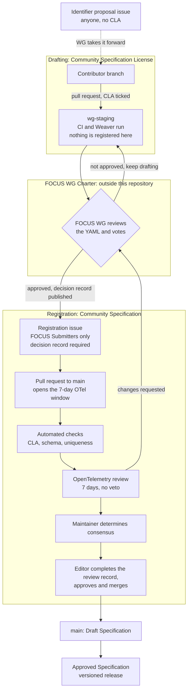

# FOCUS Semantic Conventions for OpenTelemetry (`focus.*`)

This repository is the official registry of `focus.*` identifiers: OpenTelemetry semantic-convention identifiers that link OpenTelemetry telemetry (metrics, traces and resources) to [FOCUS](https://focus.finops.org) cost, usage, and value-attribution / unit-economics data. Registering identifiers here does not change the FOCUS dataset itself.

FOCUS owns the meaning of each identifier. The focus-otel-semconv Working Group approves and publishes the registry under the Community Specification. The OpenTelemetry Semantic Conventions SIG designates reviewers who check each identifier for consistency with OpenTelemetry conventions and tooling (Weaver).

The registry is developed under the [Community Specification](https://github.com/CommunitySpecification) process of the Joint Development Foundation. The FOCUS Membership Agreement adds a second Working Group charter, for the focus-otel-semconv Working Group, which uses the Community Specification option. This repository puts that charter into practice. The FOCUS Working Group keeps its existing charter.

Registration takes two approvals, connected but independent:

1. **FOCUS WG Charter.** The FOCUS Working Group approves the normative FOCUS concept behind each identifier, under the FOCUS WG Charter and the FOCUS license.
2. **Community Specification.** With the FOCUS WG's agreement, a FOCUS Submitter submits the identifier to this registry under the Community Specification, the Contributor License Agreement and the pull request checkbox. The focus-otel-semconv Working Group then approves it by consensus.

An identifier is a pointer to the FOCUS specification. It does not restate or replace any part of it.

## Scope

This registry covers the `focus.*` namespace only. Identifiers in any other namespace are out of scope and will not be registered here.

The full Scope is in [02-scope.md](02-scope.md). That file is the "Scope.md" that the Community Specification License (§9.13) refers to, and it sets the limits of the patent commitments made under that License.

## How a `focus.*` identifier is registered

The branch an identifier passes through decides which agreement its drafting is made under. Work on `wg-staging` is contributed under the Community Specification License and its Contributor License Agreement. The FOCUS WG's own review and vote happen under the FOCUS WG Charter, outside this repository.

1. **Drafting on `wg-staging`.** The YAML definition is authored on the long-lived `wg-staging` branch in this repository, so that CI and Weaver lint run against the real artifact. Anyone taking part in the FOCUS WG can propose changes to `wg-staging` by pull request, under the Contributor License Agreement checkbox, linked to the Identifier proposal issue where there is one. Work on `wg-staging` is drafting only: nothing there is registered, and the branch is never merged into `main` as a whole.
2. **FOCUS WG approval.** The FOCUS Working Group reviews the YAML on `wg-staging` and decides whether to approve it, through its own process under the FOCUS WG Charter. The decision is written up as the FOCUS WG decision record.
3. **Registration issue.** With the FOCUS WG's approval recorded, a FOCUS Submitter opens an identifier registration issue in this repository, linking the FOCUS WG decision record and the approved `wg-staging` content.
4. **Pull request.** A FOCUS Submitter opens a pull request from the approved `wg-staging` content to `main`, linked to the issue and the FOCUS WG decision record. Opening this pull request starts the OpenTelemetry review window. The pull request describes the identifier, its rationale, compatibility considerations and the related FOCUS requirement, cited by FOCUS version and requirement ID, or the FOCUS WG-approved companion specification it comes from, by name, version and decision record. FOCUS specification text is referenced, not copied. The pull request must confirm the Contributor License Agreement (see [Contributing](#contributing)).
5. **Automated checks.** GitHub Actions validates the pull request: CLA confirmation, schema compliance, uniqueness, references and the other registry rules.
6. **OpenTelemetry review.** OpenTelemetry reviewers check the identifier for consistency with OpenTelemetry conventions. They are expected to review it within 7 days of submission. If no review is received in that time, a FOCUS Submitter follows up with the OpenTelemetry reviewers for a response. Reviewers may comment, request changes or object. An objection is considered when consensus is determined. It is not an automatic veto (see [Consensus, objections and appeals](#consensus-objections-and-appeals)). The outcome, including a window that closed without a review, is recorded in the OpenTelemetry review record in the pull request, so that the review is auditable after the fact.
7. **Suggested changes go back to the FOCUS WG.** Any change suggested by a third party, including the OpenTelemetry reviewers, goes back to the FOCUS WG for discussion, review and approval. The revision is made on `wg-staging` so the checks run against it. Once the FOCUS WG has approved the revised identifier, a FOCUS Submitter updates the pull request and the OpenTelemetry reviewers review it a second time.
8. **Maintainer approval.** The Maintainer determines consensus, weighing reviews, objections and the Participants' views in good faith (Governance §2.1). If an issue remains, the Maintainer resolves it. Otherwise, the Maintainer records consensus on the pull request and marks it as approved (Contribution Policy §4.5).
9. **Editor approval and merge.** The Editor completes the OpenTelemetry review record, gives final approval and merges the pull request. Merging is blocked without Editor approval (Contribution Policy §4.3).

**A merged pull request registers the identifier in the Draft Specification** on `main`. It becomes part of an Approved Specification when the Working Group approves a versioned release (see [Releases](#releases)).

Every decision is recorded in the issue or pull request, including decisions taken in meetings, so each registration has an auditable history.

## Participating

Anyone can take part in this repository.

| You want to… | How | CLA needed? |
|---|---|---|
| Ask a question or report a problem | Open a **Discussion or question** issue | No |
| Propose a new `focus.*` identifier | Open an **Identifier proposal** issue. The proposal is sent to the FOCUS WG, which decides whether to approve it. Pull requests for new identifiers come only from a FOCUS Submitter, after FOCUS WG approval. You can also take part in the FOCUS WG directly at [focus.finops.org](https://focus.finops.org). | No |
| Review or comment on a pull request | Comment on the pull request | No |
| Help draft an identifier the FOCUS WG is considering | Open a pull request against the `wg-staging` branch, linked to its Identifier proposal issue | Yes, via the PR checkbox |
| Fix an editorial or repository issue (typos, documentation, CI) | Open a pull request | Yes, via the PR checkbox |

Comments and reviews are not Contributions. If reviewers' ideas are adopted, they are written into the registry in the submitter's own words, not by copying the reviewer's text.

### Issue forms

All issues are opened through one of the following forms. Blank issues are disabled, so every issue records the information needed to act on it.

| Form | Who uses it | Purpose | Label | Title prefix |
|---|---|---|---|---|
| [Identifier registration](.github/ISSUE_TEMPLATE/01-identifier-registration.yaml) | FOCUS Submitters only | Register, change or deprecate a `focus.*` identifier already approved by the FOCUS WG | `spec_change` | `Spec Change:` |
| [Identifier proposal](.github/ISSUE_TEMPLATE/02-identifier-proposal.yaml) | Anyone | Suggest a new `focus.*` identifier for the FOCUS WG to consider | `proposal` | `Proposal:` |
| [Discussion or question](.github/ISSUE_TEMPLATE/03-discussion.yaml) | Anyone | Questions, editorial or repository problems, and governance or process topics | `discussion` | `Discussion:` |

These forms follow the three issue types in the [Contribution Policy](06-contributing.md) (§1.1.1). Registration issues opened by anyone other than a FOCUS Submitter will be closed and can be resubmitted as an Identifier proposal.

Code of Conduct concerns should not be raised in a public issue. Contact the people listed in [03-notices.md](03-notices.md#code-of-conduct) instead.

## Contributing

This repository does not use a CLA bot. Instead, **every pull request must tick the Contributor License Agreement checkbox** in the pull request template, confirming that:

- the contribution is made under the [Community Specification Contributor License Agreement](00-contributor-license-agreement.md), and
- the contributor is authorized to make it, including on behalf of their employer where applicable.

Pull requests without a ticked checkbox will not be reviewed or merged. The Editor confirms in the approving review that the checkbox was ticked, so the acceptance stays on record after workflow logs expire. For identifier registrations, the Editor also completes the OpenTelemetry review record in the pull request. By making a Contribution, you agree to the [Community Specification License](01-community-specification-license-v1.md), the [Governance Policy](05-governance.md), the [Contribution Policy](06-contributing.md) and the [Code of Conduct](08-code-of-conduct.md).

## Roles

| Role | Who | Responsibilities |
|---|---|---|
| Maintainer | _[To be named]_ | Initially proposed by FOCUS. Organize the work, determine and record consensus, resolve objections and disputes, mark pull requests as approved, coordinate appeals and publish releases |
| Editor | [@FinOps-Open-Cost-and-Usage-Spec/focus-otel-semconv-editors](https://github.com/orgs/FinOps-Open-Cost-and-Usage-Spec/teams/focus-otel-semconv-editors) | Initially proposed by FOCUS. Make sure the registry accurately reflects the decisions made and follows the formatting and content conventions. Give final approval and merge pull requests |
| OpenTelemetry reviewers | _[To be named]_ | Designated by the OpenTelemetry Semantic Conventions SIG. Review identifiers for technical consistency with OpenTelemetry semantic conventions and tooling. No veto or separate approval authority |
| FOCUS Submitters | _[To be named]_ (at least two) | Designated by FOCUS. Submit FOCUS WG-approved identifiers as issues and pull requests, and keep them moving through review. Any Submitter can act for any other |
| Participants | Anyone who makes a Contribution under the Community Specification License | Take part in the consensus process (Governance §1.3) |

The FOCUS Submitter role is held by two or more people designated by FOCUS, so that no single person blocks registration. The FOCUS Program Manager is normally one of them. The Working Group has one Maintainer and one Editor, held by different people. A new or additional Maintainer, or a new Editor, is selected with the approval of the Working Group Participants (Governance §1.1, §1.2).

## Consensus, objections and appeals

The Maintainer determines consensus and resolves any objection or dispute on a pull request. The Maintainer decides after considering the Participants' views in good faith and records the reasoning in writing on the issue or pull request. Unanimity is not required (Governance §2.1). When no issue remains, the Maintainer marks the pull request as approved, and the Editor gives final approval and merges it.

When a reviewer or Participant objects to a pull request, the Maintainer will do one of the following:

- send the identifier back to the FOCUS WG, if resolving the objection needs any change to the pull request; or
- decide, with written reasoning, that the objection does not prevent approval.

The Maintainer does not change an identifier directly. Any change to an identifier's definition, including its wording, goes back to the FOCUS WG. Repository and documentation changes (typos, README, CI) do not.

Any decision may be appealed by opening an issue. The Maintainer will respond in writing within a reasonable time (Governance §2.2). The Community Specification defines no automatic appeal to the FOCUS or OpenTelemetry steering committees.

## Changes and deprecation

The Working Group will define the process for changing and deprecating identifiers. Until then, these principles apply:

- Registered identifiers are never deleted or reused. They can only be deprecated.
- A change in an identifier's meaning requires a new identifier. The old one is deprecated and points to its replacement.
- Stability and deprecation follow OpenTelemetry semantic-convention practice.

## Releases

The Working Group publishes versioned releases of the registry, approved by consensus (Governance §4.3, §4.4). Each release states the FOCUS specification versions it references. It is published with the Community Specification License terms, the required attribution and the disclaimer. The versioning and release policy will be defined before the first release.

## Licensing

- **Specification content.** This includes the `focus.*` identifier definitions and their descriptions. It is licensed under the [Community Specification License](01-community-specification-license-v1.md).
- **Source code.** Any source code in this repository is licensed under the MIT License unless otherwise marked. Supporting tooling, such as Weaver templates and scripts, is kept in a separate repository.
- If the two licenses conflict, the Community Specification License applies.

See [04-license.md](04-license.md) for details.

Derivative works based on this registry must credit the focus-otel-semconv Working Group, including the material's name, version and source (License §1.2). Implementations do not need to give this credit.

## Notices

Code-of-conduct contacts, implementer license acceptances, withdrawals and patent exclusion notices are recorded in [03-notices.md](03-notices.md).

## Disclaimer

THESE MATERIALS ARE PROVIDED "AS IS." The Contributors and Licensees expressly disclaim any warranties (express, implied, or otherwise), including implied warranties of merchantability, non-infringement, fitness for a particular purpose, or title, related to the materials. The entire risk as to implementing or otherwise using the materials is assumed by the implementer and user. IN NO EVENT WILL THE CONTRIBUTORS OR LICENSEES BE LIABLE TO ANY OTHER PARTY FOR LOST PROFITS OR ANY FORM OF INDIRECT, SPECIAL, INCIDENTAL, OR CONSEQUENTIAL DAMAGES OF ANY CHARACTER FROM ANY CAUSES OF ACTION OF ANY KIND WITH RESPECT TO THIS DELIVERABLE OR ITS GOVERNING AGREEMENT, WHETHER BASED ON BREACH OF CONTRACT, TORT (INCLUDING NEGLIGENCE), OR OTHERWISE, AND WHETHER OR NOT THE OTHER MEMBER HAS BEEN ADVISED OF THE POSSIBILITY OF SUCH DAMAGE.
